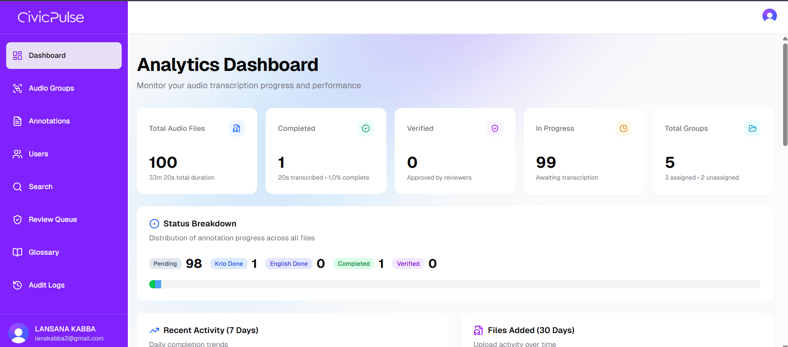
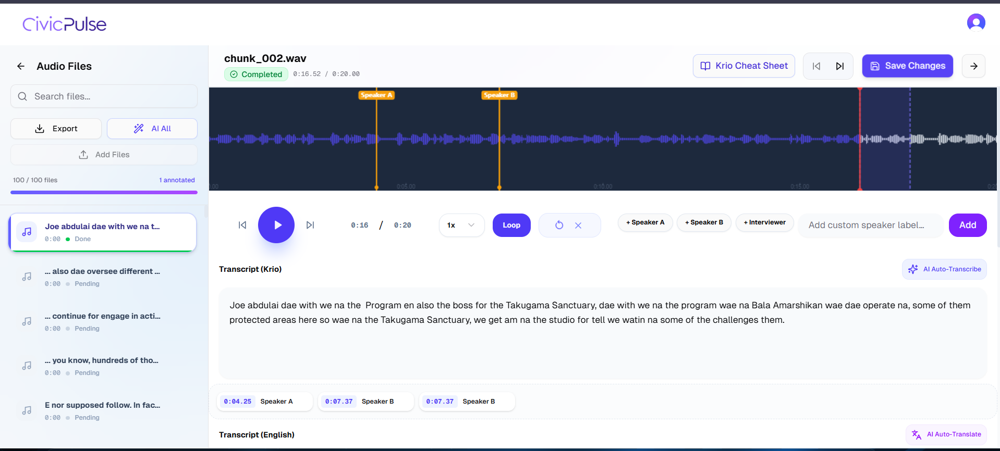
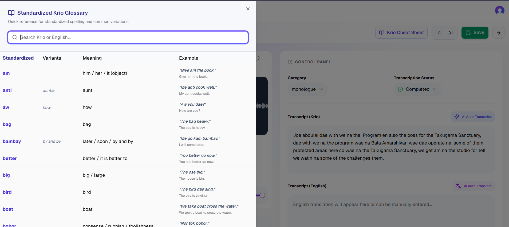
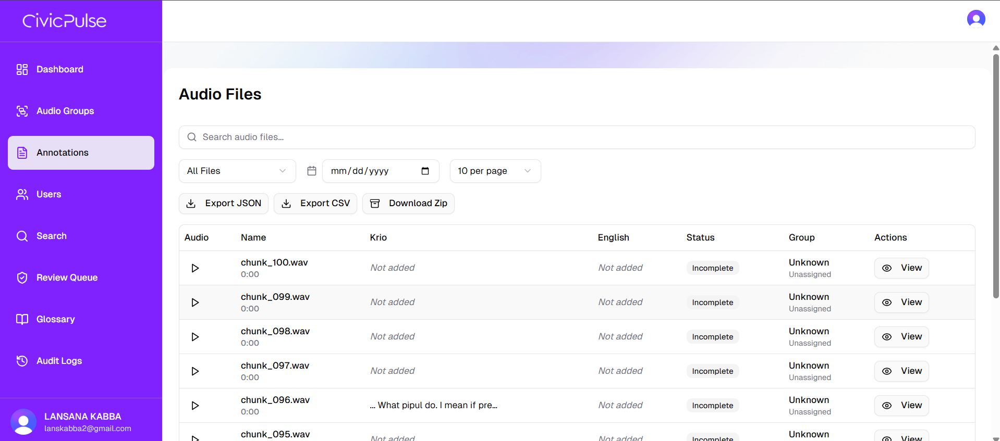

# Civic Pulse Audio Labeler

A premium, state-of-the-art audio annotation and transcription platform specifically designed for high-quality Krio language data collection and validation.

##  Key Modules & Features

### 1. Advanced Audio Annotation Workspace
The heart of the platform, providing annotators with a professional-grade environment:
*   **Dynamic Waveform Visualization**: High-fidelity waveform rendering with interactive seeking and real-time playback tracking.
*   **Speaker Tagging System**: Precision markers on the timeline to identify speaker changes, with visual indicators and labels directly on the wave.
*   **Intelligent Looping**: Select specific regions of audio to loop automatically, perfect for transcribing difficult segments.
*   **Playback Controls**: Granular speed control (0.5x - 2.0x) and instant skip forward/back (5s).
*   **AI-Assisted Transcription**: 
    *   **Pre-Krio Transcribing**: Powered by ElevenLabs Scribe v1 for one-click initial Krio drafting.
    *   **English Translation**: Integrated with Groq AI (Llama 3) to provide instant English translation suggestions from Krio text.
*   **Glossary Cheat Sheet**: A slide-out side panel containing a searchable, admin-managed Krio glossary to ensure terminology consistency across all annotators.

### 2. Administrative Control Panel
Comprehensive oversight and management tools for administrators:
*   **User Management**: Role-based access for Admins, Technical Staff, Supervisors, Reviewers, and Annotators.
*   **Group & Milestone Management**: 
    *   Organize audio into logical groups (chunks).
    *   Assign specific groups to annotators to set clear targets and milestones.
*   **Performance Tracking**: Leaderboards and analytics to monitor annotator productivity, accuracy, and completion rates.
*   **Data Review Queue**: Dedicated workflow for Reviewers to approve or reject annotations before final approval.
*   **Glossary Management**: Full CRUD interface for managing the Krio standardized dictionary with bulk import/export capabilities.

### 3. Data Export & Offline Datasets
*   **Live Export**: Export annotated data as JSON or CSV with persistent links to audio files.
*   **Offline Dataset (ZIP)**: Download the entire annotated dataset including:
    *   `dataset.json` / `dataset.csv`: Full metadata and transcriptions.
    *   `/audios` folder: All raw audio files for offline model training and archival.

## User Roles & Flow

### User Roles
*   **Admin**: Full system access, managing users and assigning work.
*   **Technical Staff**: Handles system configuration and large-scale audio uploads.
*   **Supervisor**: Monitors progress across multiple groups and annotators.
*   **Reviewer**: Quality assurance specialist who verifies the accuracy of transcripts.
*   **Annotator**: Focused on transcribing assigned audio groups using AI assistance.

### Workflow
1.  **Ingestion**: Admin uploads audio "chunks" and organizes them into **Groups**.
2.  **Assignment**: Admin assigns groups to specific **Annotators**.
3.  **Annotation**: Annotator logs in and sees *only* their assigned groups. They use the workspace to transcribe and tag speakers.
4.  **Review**: Reviewers monitor progress in real-time and verify completed annotations.
5.  **Export**: Admin exports the finalized, verified dataset for training or analysis.

## Screenshots

 ### Dashboard Overview   
  

### Audio Workspace
  
 
### Glossary Management
  

### Annotation Management
  

## 🛠 Tech Stack

*   **Framework**: Next.js 15 (App Router)
*   **Styling**: Tailwind CSS, Radix UI & Shadcn UI
*   **Database**: MongoDB (Mongoose)
*   **Authentication**: Clerk (RBAC enabled)
*   **AI Integration**: 
    *   **Transcription**: ElevenLabs Scribe v1
    *   **Translation**: Groq AI (Llama 3 / Mixtral)
*   **Storage**: AWS S3 (High-performance audio streaming)
*   **Libraries**: JSZip (Offline exports), Recharts (Analytics), Framer Motion (Animations)

## 📁 Project Structure

```text
/
├── app/                    # Next.js 15 App Router
│   ├── (admin)/            # Admin-only dashboard and controls
│   ├── (app)/              # Main application (Annotator views)
│   ├── (auth)/             # Authentication routes (Clerk)
│   ├── actions/            # Server Actions (Database & Business Logic)
│   ├── api/                # API Routes (S3, Uploads)
│   ├── actions.ts          # Core Shared Server Actions
│   └── transcribe.ts       # AI Transcription & Translation Logic
├── components/             # UI Components
│   ├── ui/                 # Shadcn/Radix Primitives
│   ├── simple-audio-player/# Advanced Audio Annotation Workspace
│   ├── group-detail-client/# Data Export & Group Management
│   └── glossary/           # Dictionary Management
├── lib/                    # Shared Utilities & Models
│   ├── models/             # Mongoose Schemas (AudioFile, AudioGroup, User)
│   ├── mongodb.ts          # Database Connection logic
│   └── utils.ts            # Formatting & UI Utilities
├── public/                 # Static Assets & Screenshots
└── tailwind.config.ts      # Styling Configuration
```

## 🏃‍♂️ Getting Started

### Prerequisites
*   Node.js 20+ 
*   MongoDB Instance
*   Clerk Account
*   AWS S3 Bucket

### Installation

1. **Clone & Install**:
   ```bash
   npm install
   ```

2. **Environment Setup**:
   Create a `.env` file with `MONGO_URL`, `CLERK_SECRET_KEY`, `S3_BUCKET_NAME`, `GROQ_API_KEY`, and `ELEVENLABS_API_KEY`.

3. **Run**:
   ```bash
   npm run dev
   ```

---
Developed by the **Limdev Team**
